<h1 align="center"></h1>

**A calmer, clearer home for your Home Assistant automations, scripts, scenes and helpers.**
Real folders instead of one long list, flows you read like sentences, and no YAML in sight.

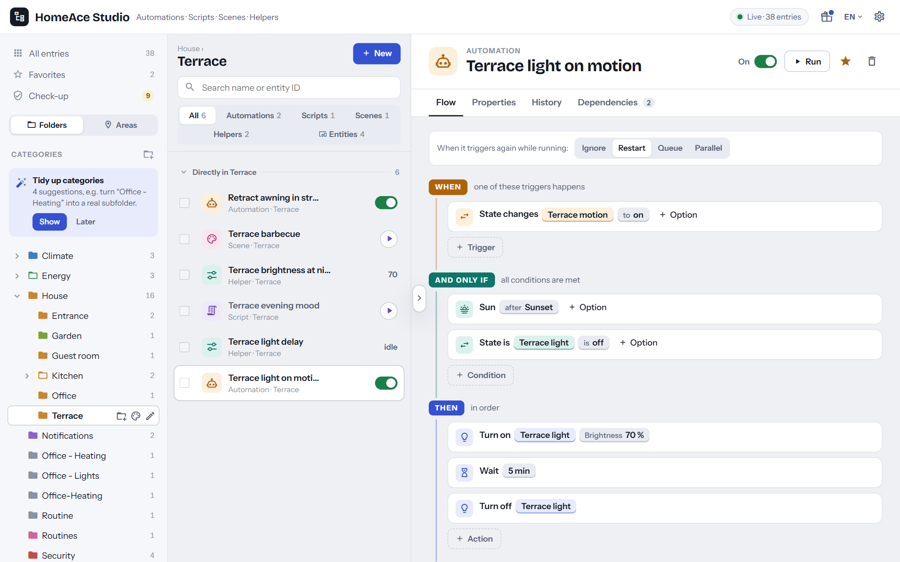

HomeAce Studio is a Home Assistant app (add-on). It works on top of what HA already stores:
your categories, entities and automations stay in Home Assistant and keep working without it.

> **Status: early preview.** It is used on its author's own Home Assistant, but it is young. Make a backup
> before you let it change things, and expect rough edges.

## What it does

**Edit scenes without your lights changing.** In Home Assistant, changing a scene means switching it
on live. HomeAce Studio leaves the room as it is: set brightness, white tone or colour, cover
positions and thermostats, and each device shows what it is doing right now for comparison. Want to
see it? *Preview* shows the whole scene, *Try* a single device, and both put everything back
afterwards. *Take the current state* reads a device without switching it, and whatever the editor has
no control for (an effect, a fan speed) is kept and named.

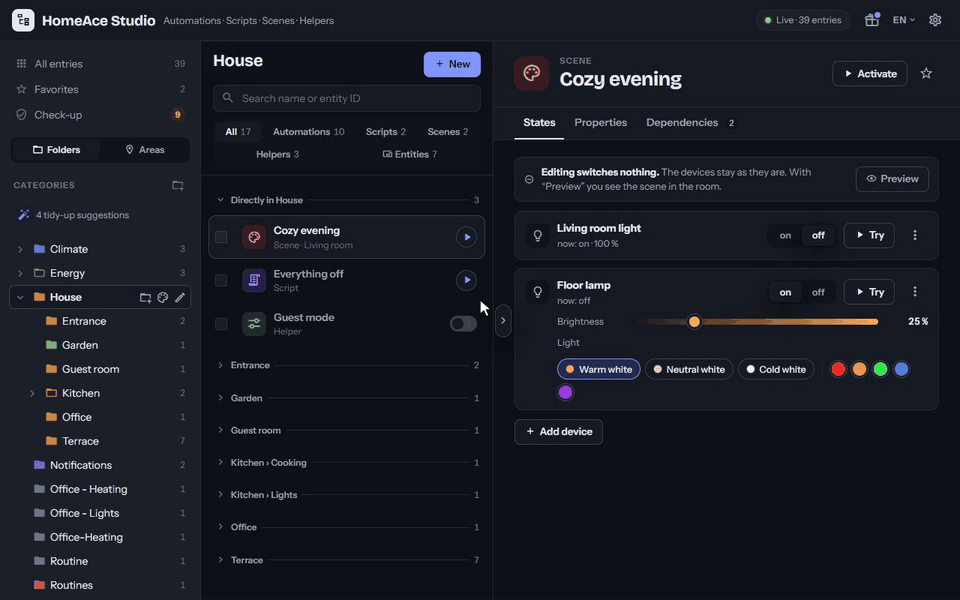

**Devices in folders, dragged into flows.** Turn on the filter *Entities* and lights, sensors and
everything else join the list, each in its folder. Drag a device straight into an automation: drop
the motion sensor on *When* and pick *Motion detected*, the lamp on *Then* and pick *Turn on*.
Sections that fit light up, the others say why not. Helpers, scripts and scenes from the list can be
dragged in the same way; a script either runs while the automation waits for it, or starts alongside.

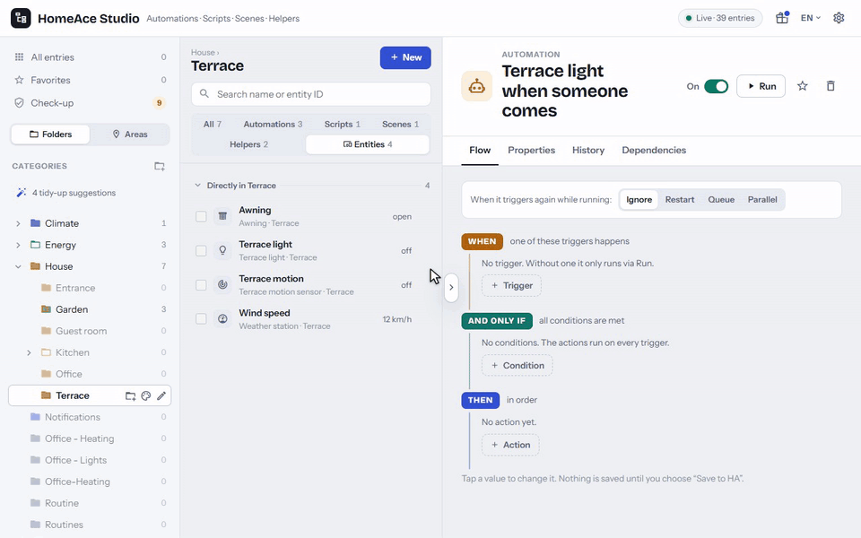

**Folders that nest.** HA categories are flat. HomeAce Studio shows `House/Terrace` as a folder
inside `House`, in every scope at once, and HA's own UI still reads it. Drag entries and devices onto
folders, or tick several and move them together, rename a folder with a preview of every HA category
it touches, and give folders colors that subfolders inherit. Device folders are stored in Home
Assistant and its backups too, without crowding HA's own menus.

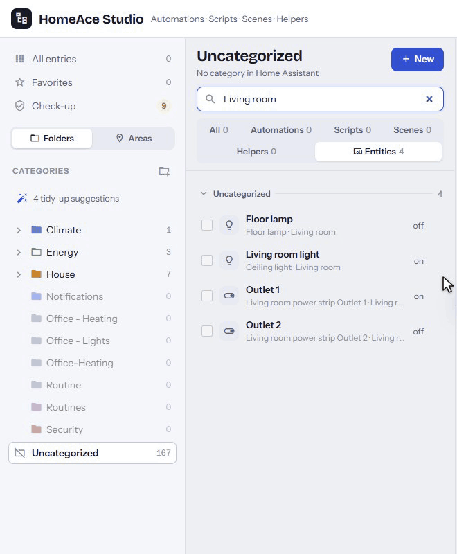

**Flows as sentences.** Automations read as *When … / And only if … / Then …*, scripts as a
sequence. Tap any value to change it in a small editor made for its type (entity, state, number,
duration, time, option list). Add, move, duplicate, disable or delete blocks; nested *if / then*,
*choose*, *repeat* and *parallel* blocks are shown as such. Nothing reaches HA until you choose
*Save to HA*, and blocks it does not know yet survive a save untouched.

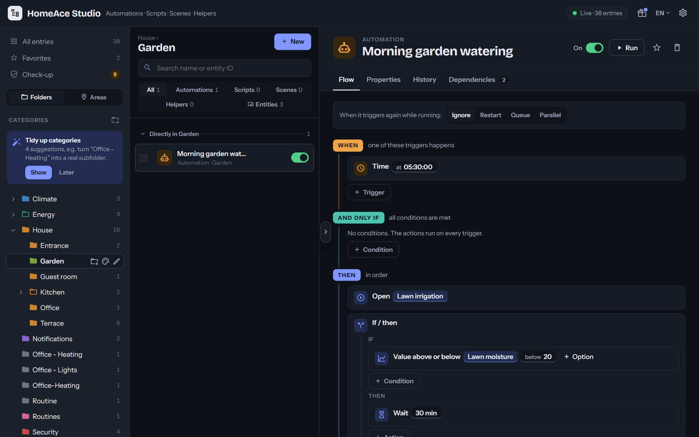

**Everything about an entry in one place.** Name, icon, area, labels, folder, on/off, run, notes
and favorites (the last two live only in HomeAce Studio). Create automations, scripts, scenes and
eight kinds of helpers in a few clicks; delete them again when they are not needed. Change an entity ID and
HomeAce Studio rewrites every automation and script that uses it (it lists them first). Aliases for
Assist, hidden and disabled sit right there too; disabling tells you which flows still need it.

**Helpers you can actually set up.** Every storage helper (toggle, button, number, text, dropdown,
date/time, counter, timer) has a *Settings* tab for its ranges, steps, options, lengths and
durations. A value Home Assistant would refuse is marked red before you save.

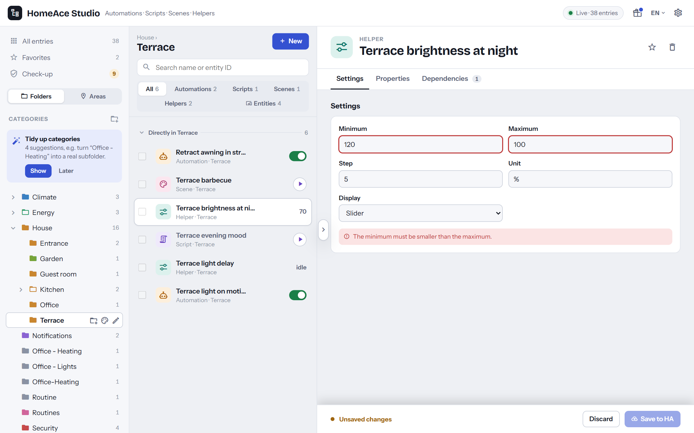

**Labels, managed where you use them.** Give an entry its labels from a search, create one by typing
its name, change name, colour and icon, or tick several entries and label them in one go. Before a
label is deleted, HomeAce Studio shows where it is still used, including automations that switch
everything with that label.

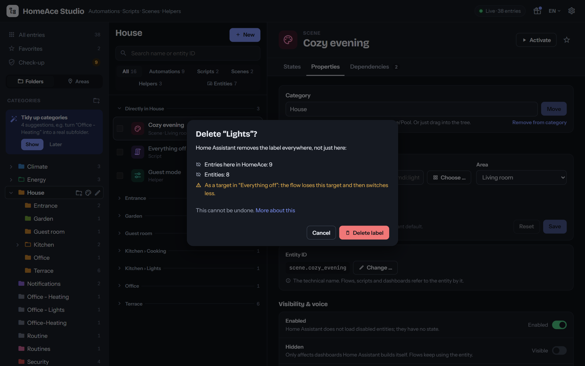

**Quick everyday handling.** Double click a name (or press F2) to rename it in place, in the list,
the title or the folder tree, with *Undo* in the toast. Duplicate an automation, script or helper next
to the pencil: the copy keeps folder, labels and area (and a helper's settings), which HA's own
duplicate does not. Sort folders by dragging them, fold the details away for a wider list, walk the
list with the arrow keys.

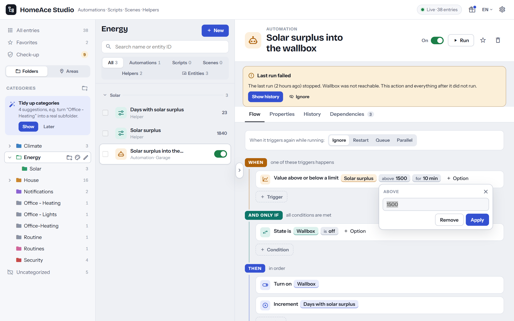

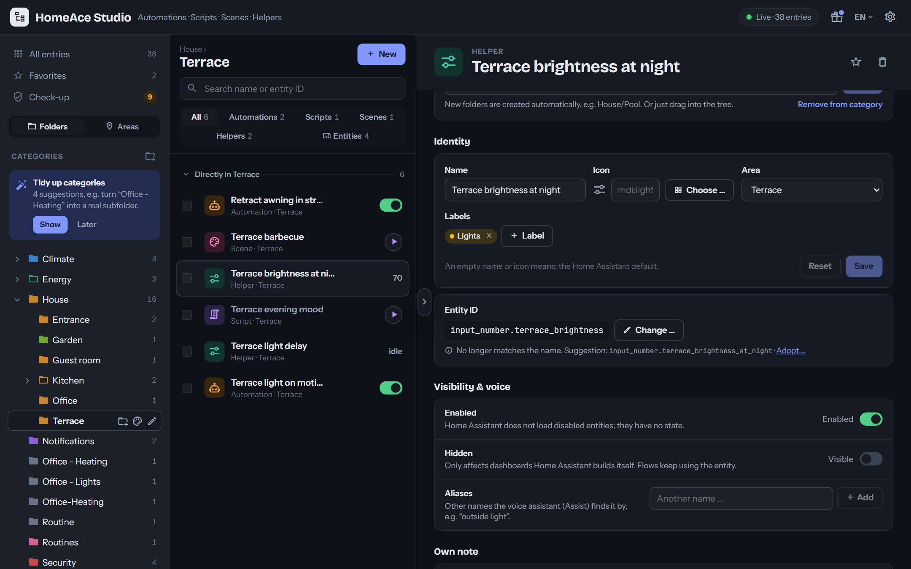

**Tidy up old categories.** Many homes fake subfolders with names like `Office - Heating`.
HomeAce Studio spots them, proposes real subfolders and merges near-duplicates such as `Routine`
and `Routines`. You tick every line yourself and see each change in Home Assistant before it
happens.

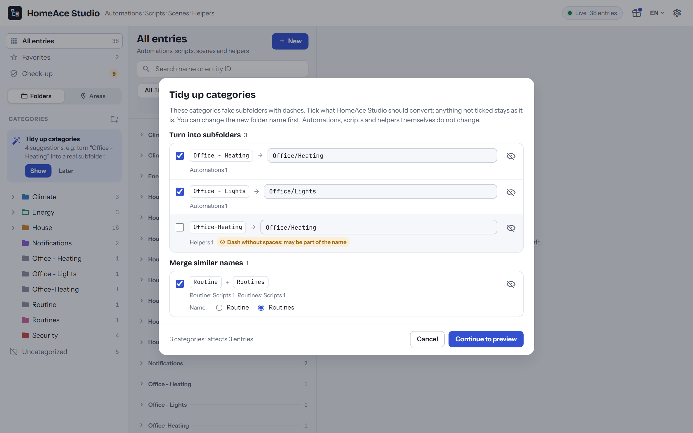

**Let an AI suggest a folder structure.** Switch on the optional AI access (MCP) and an assistant
such as Claude can read your folders and entries and send a plan: rename folders, sort entries
in. It cannot change anything itself. The plan waits in HomeAce Studio, you untick what you do not
want, check the preview and apply it. Flows, states and notes are never shown to the AI.


**Pick devices like a person, not like a database.** Choosing a light or sensor for a flow starts
with the room: pick an area, see its devices with their functions ("Front door sensor → Battery")
and their state right now, or search with words in any order. Filter by area, label or kind; the
devices the flow already uses come first. "All lights · Living room" targets the whole room,
including lights you add later.

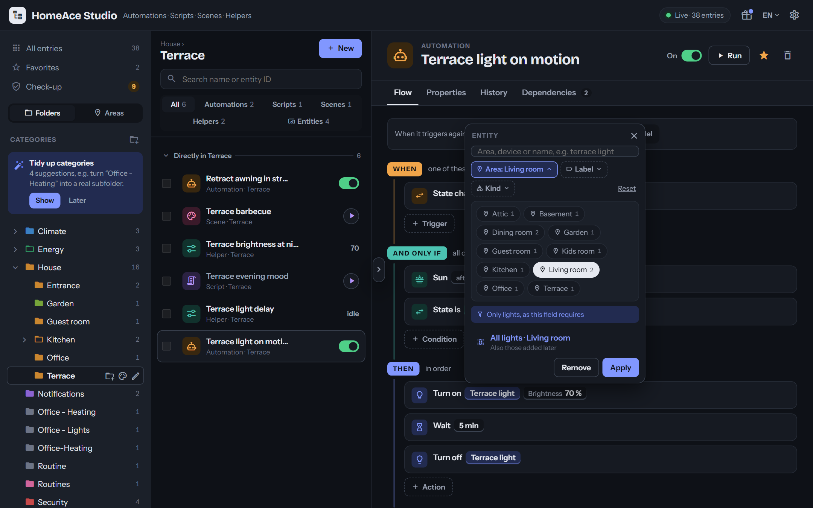

**Check-up, no setup needed.** Even if you never sort anything, HomeAce Studio shows what needs a
look: automations that use devices which no longer exist (marked red in the flow) or are offline
right now, flows whose last run stopped with an error, helpers no automation or script uses, and
automations that have not run for a month. New ones get time first. Ignore what is fine as it is.

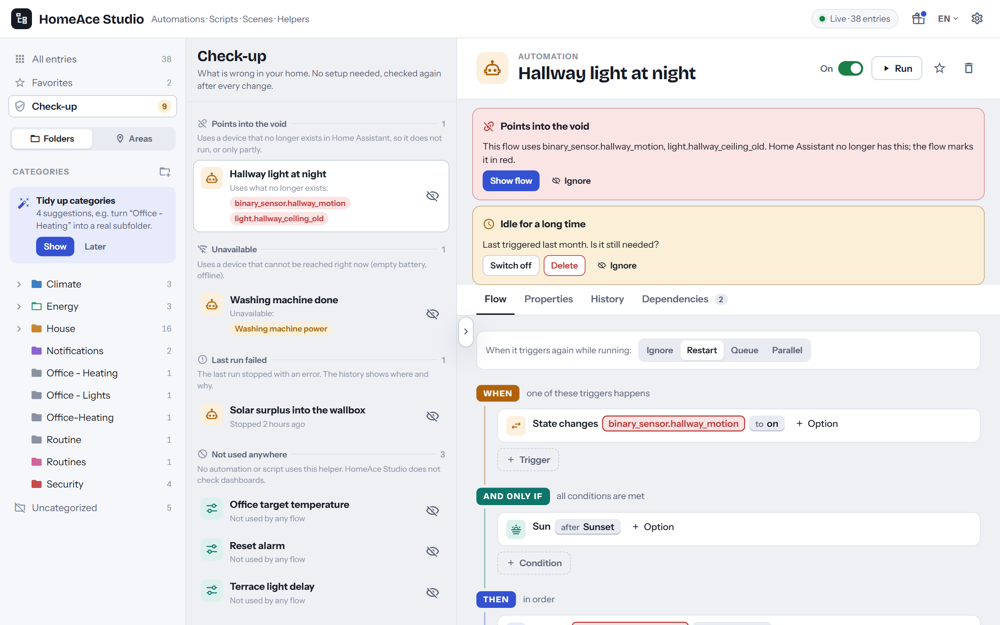

**What happened, step by step.** The *History* tab lists the runs Home Assistant kept: finished,
condition not met, stopped by an error, still running, restarted or ignored. Pick one and it goes
through the flow block by block: what triggered it, what each condition found ("was 14, wanted
below 20"), which branch an *if* took, how long it waited, and errors in plain words. *Show on the
flow* puts the run right onto the blocks you edit. One click lets HA keep 20 runs instead of 5.

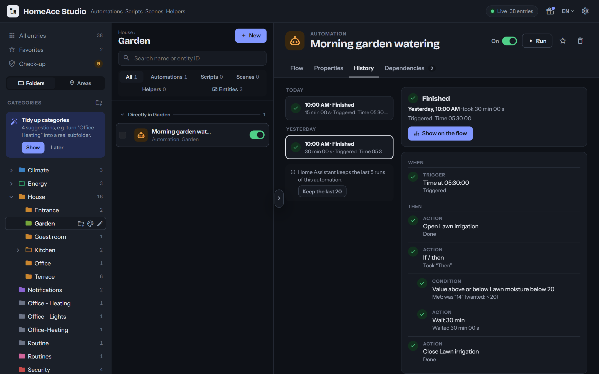

**Areas without any setup.** Switch the tree from folders to areas. An entry without an area of its
own counts in the areas of the devices it uses, a helper in those of the flows that use it, and
every row says why ("through Alarm panel"). Create, rename and delete areas right there, drag
entries onto an area, and *Tidy up in one click* turns the areas into real folders after a preview.

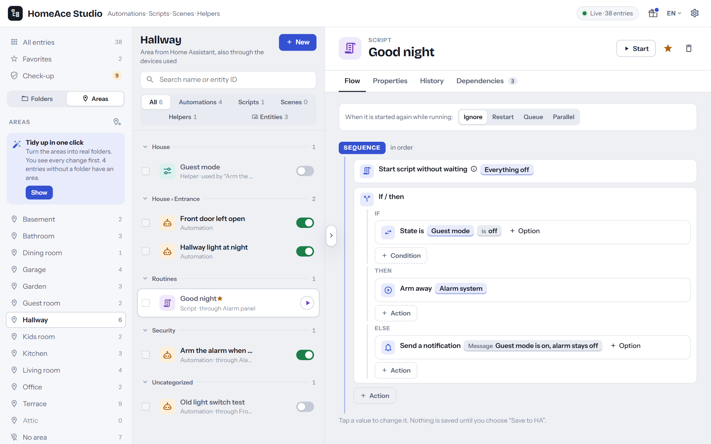

**See what depends on what.** Every automation, script, scene and helper has a *Dependencies* tab:
what it uses, grouped by what it does with it (triggers on, checks, controls, reads values,
starts), with the current state, and who uses it in turn. Deleting something that is still used
names the flows that would break.

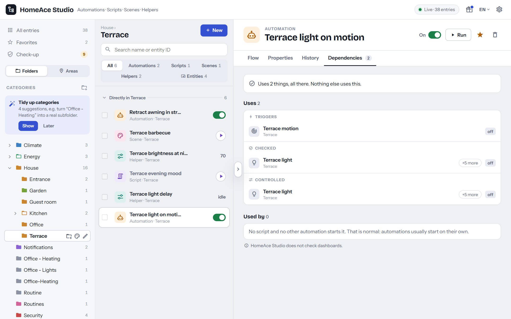

**Made to be used everywhere.** Light and dark mode, five languages (German, English, French, Spanish and Russian), all columns resizable,
and on a phone the list comes first and the details slide in full screen. Technical details such
as entity IDs stay hidden until you switch them on. Opened from the Home Assistant sidebar, the
settings you choose follow you to every device.

<p align="center">
  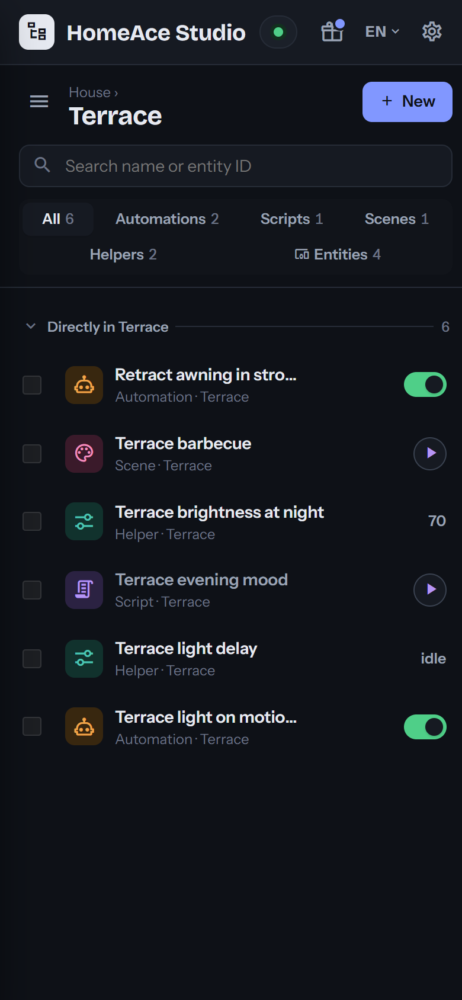
  &nbsp;&nbsp;
  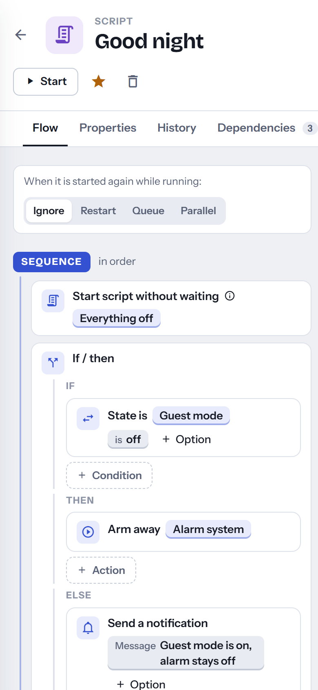
</p>

**Live.** Changes made in HA show up right away, without reloading.

## Good to know

The settings window has a *Good to know* tab for quirks like these; a few to start with:

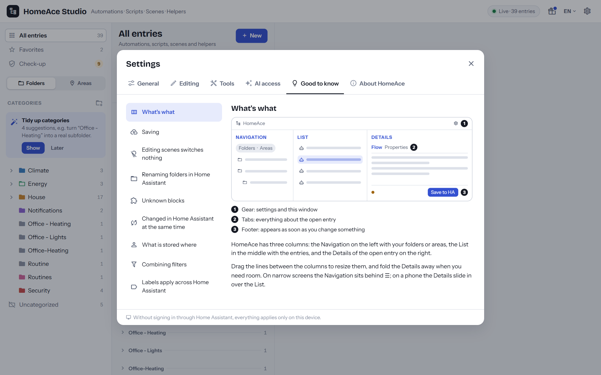

- **Combine filters:** Ctrl+click (⌘+click on a Mac) adds a filter, for example *Automations* and
  *Entities* together. Right-click or a long press on a filter does the same; a plain click shows
  only that one.
- **Rename in place:** double click a name or press F2, in the list, the title or the folder tree.
- **Walk the list** with the arrow keys; the details follow.
- **Into a branch:** drop an entity right into the *then* or *else* of an if block. Dropped next to
  it, HomeAce Studio asks where exactly.
- **On a phone,** tap an entity instead of dragging it: it offers the same places.

## What comes next

What is released, what is being built and what comes after is in the [roadmap](ROADMAP.md).

## Try it without Home Assistant

A demo mode runs the whole UI against an invented home kept in memory (Node.js 22 or newer):

```bash
cd frontend && npm install && npm run build
cd ../backend && npm install && npm run build
HOMEACE_DEMO=true PORT=3100 STATIC_DIR=../frontend/dist node dist/main.js
```

Then open <http://localhost:3100>. Everything works, nothing is saved. The screenshots above come
from this demo.

## Install on Home Assistant

HomeAce Studio needs Home Assistant 2025.8 or newer, as Home Assistant OS or Supervised (the app
store), on amd64 or aarch64 (Raspberry Pi 4/5, HA Green and Yellow).

[](https://my.home-assistant.io/redirect/supervisor_add_addon_repository/?repository_url=https%3A%2F%2Fgithub.com%2Fshadowtsw%2Fhomeace-studio)

1. Click the button above, or add the repository by hand: Settings → Apps → App store → ⋮ →
   Repositories → `https://github.com/shadowtsw/homeace-studio`.
2. Open **HomeAce Studio** in the app store, install and start it, and turn on **Show in sidebar**.

Updates arrive like for any other app. The app documentation explains the AI access:
[homeace-studio/DOCS.md](homeace-studio/DOCS.md).

The same repository also has **HomeAce Studio Preview**: the next release a few days before it is
announced, installable next to the normal app ([homeace-studio-preview/DOCS.md](homeace-studio-preview/DOCS.md)).

## For developers

```text
frontend/        Vue 3 + TypeScript, own components, vue-i18n
backend/         NestJS; talks to HA over its WebSocket and REST APIs and serves the built UI
homeace-studio/  app definition for HA: config.yaml, Dockerfile, DOCS.md, CHANGELOG.md
scripts/         build-addon.mjs (assembles the app folder), screenshots.mjs and recordings.mjs
                 (README pictures and clips), ha-check/ (tests a new HA version in Docker)
docs/            setup, architecture, API, decisions
```

Local development against a real HA, a local test environment (`node scripts/local.mjs`, or
`docker compose`), tests and the app build are described in
[docs/setup.md](docs/setup.md); the design is in [docs/architecture.md](docs/architecture.md).

Bug reports and ideas are welcome as [issues](https://github.com/shadowtsw/homeace-studio/issues/new/choose);
how to contribute is in [CONTRIBUTING.md](CONTRIBUTING.md). Security issues please privately, see
[SECURITY.md](SECURITY.md).

**Translations:** the Russian one comes from [pcmaster4u](https://github.com/pcmaster4u), thank you! French
and Spanish are machine-assisted; if one of them is your language, corrections are very welcome.

## Support

HomeAce Studio is free and open source. If it saves you time, you can buy me a coffee:

<a href="https://ko-fi.com/gerrul3r"></a>
<a href="https://buymeacoffee.com/gerrul3r"></a>

## License

[MIT](LICENSE). HomeAce Studio is an independent project and not affiliated with Home Assistant or
Nabu Casa.
